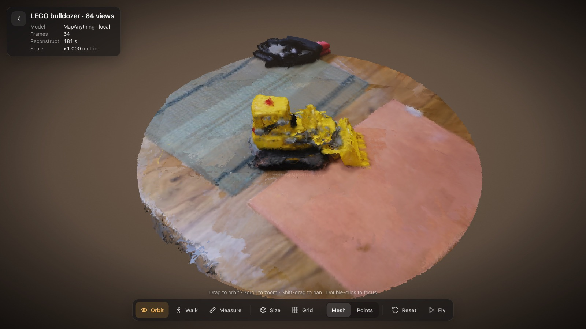
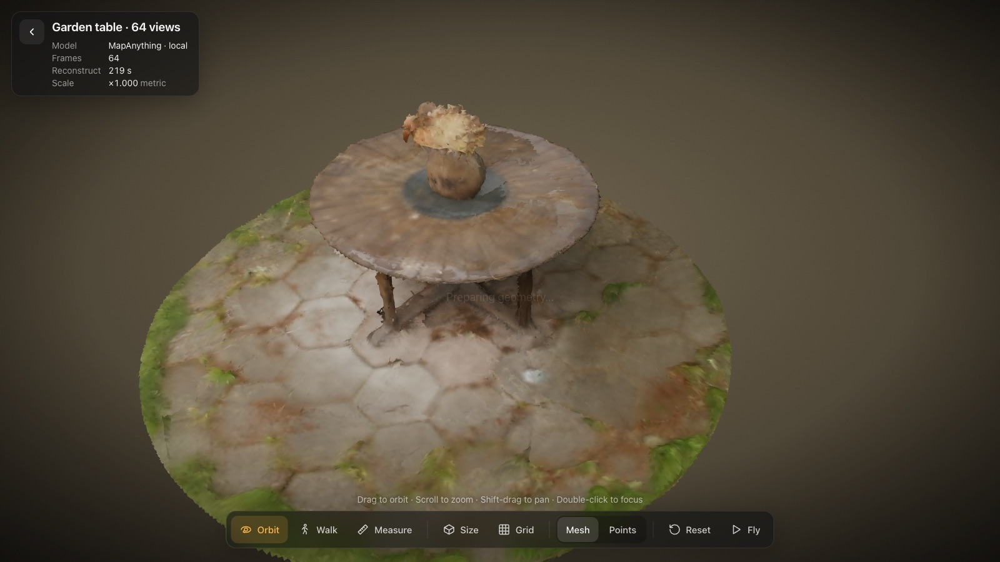
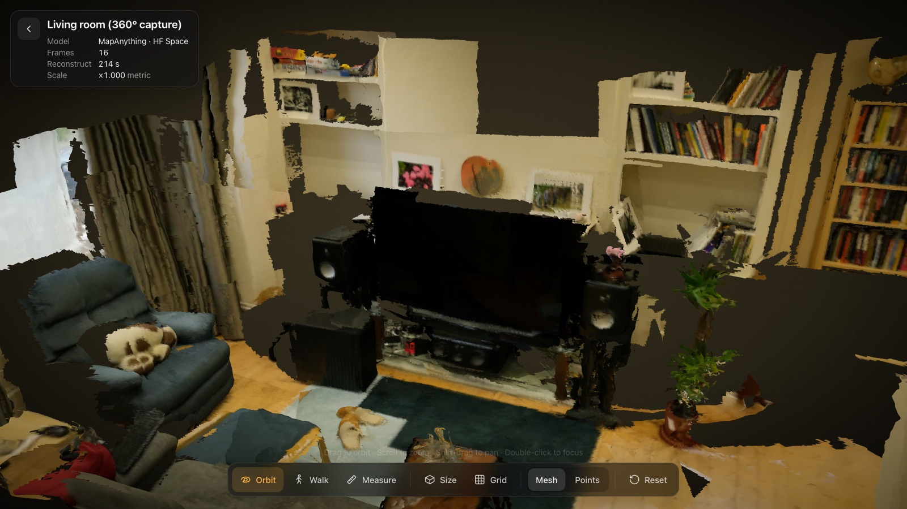
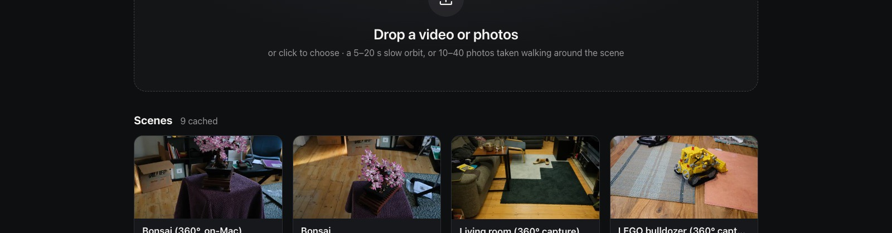

# v3d: phone video in, metric 3D scene out

Upload a short video, or a handful of photos, of a real place or object. v3d reconstructs it as a **3D scene in
real-world metres** that you can orbit, walk through and **measure** in the browser.

It runs on an Apple-Silicon Mac. The 3D model ([MapAnything](https://github.com/facebookresearch/map-anything),
Meta, 2025) runs either **locally on the Mac's GPU** or on a free Hugging Face GPU.

| | |
|---|---|
|  |  |
| **LEGO bulldozer**: 64 photos from a full orbit, about 3 min on an M4 | **Garden table**: round table, vase and hexagonal paving |
|  |  |
| **Living room**: measure furniture, check ceiling height | **Gallery**: drop a video or photos, cached scenes |

## What it can do

- **Video or photos in.** Drop an `.mp4`/`.mov`, or 10–40 JPG/PNG photos, onto the page.
- **Metric 3D out.** The output is a coloured mesh (`scene.glb`) in metres, gravity-levelled: the floor is found with
  RANSAC and moved to y = 0.
- **A viewer in the browser:**
  - orbit, zoom and pan;
  - first-person walk mode (WASD);
  - fly along the original camera path;
  - Mesh view, or a splat-like Points view.
- **Measuring.** Click two points to get a distance in cm/m, show the room's width × depth × height, or calibrate
  against a known length (e.g. an A4 sheet) to rescale everything.
- **Three interchangeable backends:**

  | Backend | Speed | Needs |
  |---|---|---|
  | local Mac GPU (MPS) | ~45 s for 16 views, ~3.5 min for 64 | no internet once installed |
  | Hugging Face Space | — | free daily GPU quota |
  | Replicate | — | paid |

- **Caching.** Every scene is cached by video hash, so re-opening is instant and works offline.
- **Experimental photoreal mode.** Gaussian splats are trained on-device (pycolmap + Brush) and rendered with
  Spark. The metric alignment is unfinished.

## How it works



1. **Ingest.** ffmpeg downscales the clip and samples N evenly spaced frames (16 by default, up to 64+). A set of
   photos is first stitched into a short clip, so the same path handles both.

   

2. **Reconstruct.** MapAnything predicts, for every pixel of every frame, a ray, a depth and a confidence. It also
   predicts each camera's pose and one metric scale factor for the whole scene. Together these are a metric
   pointmap, which is then exported as per-frame depth meshes.

   

3. **Postprocess** (numpy + trimesh):
   - drop "flying pixel" triangles at depth edges and small floating islands;
   - optionally crop to the area the cameras orbited;
   - find the floor and level it;
   - decimate to a browser-friendly budget.

   

4. **View.** three.js (r178) renders the vertex colours unlit, so they match the photos. three-mesh-bvh makes
   raycasting fast for measuring. All JS is vendored, so the viewer works offline.

   

## Local setup

**Requirements:**
- macOS on Apple Silicon (M1 or later), 16 GB+ RAM. Tested on an M4 with 24 GB.
- [`uv`](https://docs.astral.sh/uv/), `ffmpeg` (`brew install ffmpeg`), Chrome or Safari.
- About 8 GB of disk: ~1.5 GB of Python deps plus the 4.9 GB model.

### 1. Clone and install

```bash
git clone https://github.com/vermarjun/v3d.git && cd v3d
uv sync --project server --extra local    # FastAPI, trimesh, torch (MPS) and MapAnything from Meta's repo
```

Without `--extra local` you get a light install that can only use the Hugging Face or Replicate backends.

### 2. Configure

Create `server/.env`:

```bash
VIDEO3D_BACKEND=local      # local | hf-space | replicate | auto
HF_TOKEN=hf_xxx            # free "Read" token from https://huggingface.co/settings/tokens
# REPLICATE_API_TOKEN=r8_xxx   # only for the replicate backend
```

The HF token is needed both to download the model and to use the Hugging Face Space backend.

### 3. Download the model weights (4.9 GB)

The first local run downloads `facebook/map-anything` (1.23 B parameters, FP32) into `~/.cache/huggingface`
automatically. To fetch it up front:

```bash
uvx --from "huggingface_hub[hf_xet]" hf download facebook/map-anything
```

A DINOv2 backbone (a few MB of code via torch.hub) is fetched on first run too.

> **Slow download?** Single-stream Hugging Face downloads can crawl at a fraction of a MB/s on some networks.
> Download `model.safetensors` from the CDN with parallel connections instead
> (`aria2c -x16 -s16 "<resolved CDN url>"`), then place it in the HF cache under
> `models--facebook--map-anything/snapshots/<rev>/`.

**Model licence:** `facebook/map-anything` is **CC-BY-NC 4.0**, for non-commercial use only. For commercial use,
switch to `facebook/map-anything-apache` (Apache-2.0). It's the same architecture, and the backend falls back to it
automatically if the first is unavailable.

### 4. Run

```bash
./run.sh       # starts http://127.0.0.1:8000 and opens the browser
```

Drop a video or photos on the page. With the local backend a 16-frame scene takes about 45 s on an M4. The first
run also takes ~20 s to load the model.

### Command line (pre-build scenes)

```bash
# build a scene from a clip (same pipeline as the web upload)
uv run --project server --extra local video3d-ingest clip.mp4 --name "My room"

# best quality for object-centric 360° captures: more views, cropped to the orbit
VIDEO3D_FRAMES=64 VIDEO3D_CROP=0.8 uv run --project server --extra local video3d-ingest clip.mp4 --name "Bulldozer"
```

| Variable | Default | Meaning |
|---|---|---|
| `VIDEO3D_BACKEND` | `auto` | `local`, `hf-space`, `replicate`, or `auto` (try them in order) |
| `VIDEO3D_FRAMES` | `16` | frames sent to the model. More views mean fewer holes, but slower and more memory (64 frames ≈ 8 GB) |
| `VIDEO3D_CROP` | off | keep only the disc the cameras orbited, as a fraction of the orbit radius (e.g. `0.8`) |
| `VIDEO3D_LOCAL_RES` | `518` | model input resolution |
| `VIDEO3D_LOCAL_DEVICE` | auto | force `mps` or `cpu` |
| `VIDEO3D_DATA` | `data/` | where cached scenes live |

### Photoreal mode (experimental)

```bash
tools/install_brush.sh                                        # Brush splat trainer (macOS arm64)
uv run --project server --extra splat video3d-splat <scene_id>   # pycolmap SfM → Brush → align → splat.ply
```

### Tests

```bash
uv run --project server pytest
```

## Getting good results

Reconstruction quality depends far more on **coverage** than on the model:

- **Orbit the subject.** Walk a full circle around one object or table. A one-sided sweep leaves the back as a hole.
- **Use 10–20 s of slow, steady motion,** good light and a static scene. Moving people turn into ghosts; glass and
  mirrors break depth.
- **More views fill gaps.** Try `VIDEO3D_FRAMES=48–64` for showcase scenes.
- **For reference-quality inputs,** use the [Mip-NeRF 360](https://jonbarron.info/mipnerf360/) scenes (e.g.
  `kitchen`, `garden`; per-scene images in the HF dataset `nvs-bench/mipnerf360`).

Limits:
- Scale is predicted by the model. On test scenes a table measured 75.5 cm against a real ~74 cm. Use **Calibrate**
  when you need exact numbers.
- Surfaces no camera saw cannot be reconstructed.

## Project layout

| Path | Contents |
|---|---|
| `server/video3d/` | FastAPI app (`app.py`), job runner (`pipeline.py`), backends (`backends/local.py`, `hf_space.py`, `replicate.py`), cleaning and levelling (`postprocess.py`), CLI (`cli.py`), splats (`splat.py`) |
| `web/` | viewer: `index.html`, `app.js`, `viewer.js`, `measure.js`, `splat.js`, vendored three.js, three-mesh-bvh and Spark |
| `tools/` | Brush installer, scene crop helper |
| `fixtures/sample.mp4` | tiny test clip |
| `data/scenes/<id>/` | generated at runtime (gitignored): `scene.glb`, `meta.json`, `thumb.jpg`, `input.mp4` |

### HTTP API

| Method | Path | Does |
|---|---|---|
| `POST` | `/api/scenes` | multipart `video`, or several `photos`, plus an optional `name`. Returns `{id, status}` |
| `GET` | `/api/scenes` | list of cached scenes |
| `GET` | `/api/scenes/{id}` | status, progress and asset URLs |
| `POST` | `/api/scenes/{id}/calibration` | `{scale_factor}` |
| `GET` | `/scenes/{id}/scene.glb`, `meta.json`, … | static assets |

## Credits

- [MapAnything](https://github.com/facebookresearch/map-anything) (Meta): the reconstruction model
- [three.js](https://threejs.org), [three-mesh-bvh](https://github.com/gkjohnson/three-mesh-bvh), [Spark](https://sparkjs.dev): rendering
- [Brush](https://github.com/ArthurBrussee/brush) and [pycolmap](https://github.com/colmap/pycolmap): Gaussian splats
- [Mip-NeRF 360](https://jonbarron.info/mipnerf360/): sample captures
